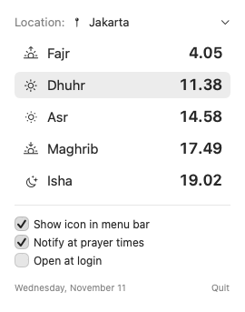
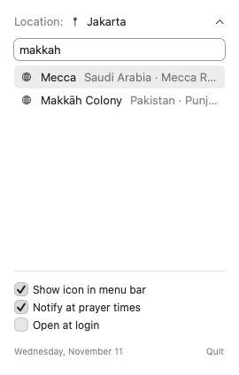

<p align="center">
  
</p>

<h1 align="center">Prayer Times</h1>

<p align="center">
  A tiny macOS menu bar app that shows the next prayer time, with no Dock icon and no dependencies.
</p>

<p align="center">
  
  &nbsp;&nbsp;
  
</p>

## Features

- **Next prayer in the menu bar.** For example `☀ Dhuhr 11:38`. The icon changes with the time of day and can be hidden.
- **Today's schedule in one click.** Shows Fajr, Dhuhr, Asr, Maghrib and Isha, with the next one highlighted.
- **Automatic or manual location.** GPS follows you when you travel. Or search any city in the world; results load as you type.
- **Notifications.** A banner and sound at each prayer time, for the location you have selected.
- **Small and light.** About 800 KB, a single Swift file, no dependencies. Uses almost no CPU or memory.
- **Native.** Light and dark mode, VoiceOver labels, full keyboard control (↑ ↓ Return, ⌘Q), and an option to open at login.

## Install

Requires macOS 14 or later.

1. Download `PrayerTimes-vX.Y.Z.dmg` from the [latest release](https://github.com/Mqdd27/prayer-times/releases/latest).
2. Open the DMG and drag **PrayerTimes** onto the **Applications** shortcut.
3. The app is not notarized, so macOS blocks the first launch. Remove the download flag once:

   ```sh
   xattr -dr com.apple.quarantine /Applications/PrayerTimes.app
   ```

   Or open it once, then go to **System Settings → Privacy & Security** and click **Open Anyway**.

On first launch, allow **Location** (for automatic mode) and **Notifications**. If you miss either prompt, the panel shows a link straight to the right System Settings page.

### Build from source

Requires the Xcode Command Line Tools (`xcode-select --install`).

```sh
./build.sh
cp -R build/PrayerTimes.app /Applications/
open /Applications/PrayerTimes.app
```

## Usage

| Action | How |
|---|---|
| See today's times | Click the prayer time in the menu bar |
| Change location | Click **Location:** and type a city name. ↑ ↓ to move, Return to pick |
| Back to GPS | Choose **Automatic (GPS)** at the top of the list |
| Recent cities | Your last 8 picks appear when the search field is empty, and work offline |
| Remove a recent city | Hover it and click ✕, right-click → **Remove from History**, or highlight it and press ⌘⌫ |
| Clear all recent cities | Click **Clear History** below the list |
| Quit | **Quit** in the panel, or ⌘Q |

## How times are calculated

Times are computed locally from the sun's position, following the method of Indonesia's Ministry of Religious Affairs (Kemenag RI):

| Prayer | Rule |
|---|---|
| Fajr | Sun 20° below the horizon |
| Dhuhr | Solar noon |
| Asr | Shadow = object length + noon shadow (Shafi'i) |
| Maghrib | Sunset |
| Isha | Sun 18° below the horizon |

A 2-minute safety margin (*ihtiyat*) is added to each time. At high latitudes, where the sun never gets low enough in summer, Fajr and Isha fall back to a fixed share of the night. Outside Indonesia, results can differ by a few minutes from local timetables that use another method (MWL, ISNA, Umm al-Qura).

## Privacy

- **Location** is used only on your Mac to calculate times. It is never sent anywhere.
- **City search** sends only the text you type to the [Open-Meteo Geocoding API](https://open-meteo.com/en/docs/geocoding-api).
- No analytics and no tracking.

## Project layout

| File | Purpose |
|---|---|
| `PrayerTimes.swift` | The whole app: calculation, location, notifications and UI |
| `build.sh` | Compiles a universal binary and packages `build/PrayerTimes.app` |
| `.github/workflows/release.yml` | Publishes a GitHub Release (next patch version) on every push to `master` that changes the app |
| `make-icon.swift` | Renders `AppIcon.icns` from an illustration |
| `AppIcon.icns` | App icon |
| `assets/` | Images used by this README |

## Credits

- Icon illustration: *Hand-drawn flat design salat illustration* by [Freepik](https://www.freepik.com).
- Geocoding: [Open-Meteo](https://open-meteo.com) (data from GeoNames, CC BY 4.0).
